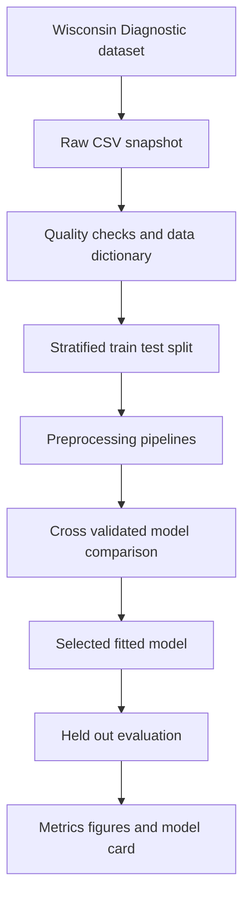

# Solution architecture

The split occurs before any learned preprocessing. Scaling is contained inside each relevant sklearn pipeline, so every cross-validation fold learns its transformation from training observations only. The held-out test set is used once for the final evaluation.
